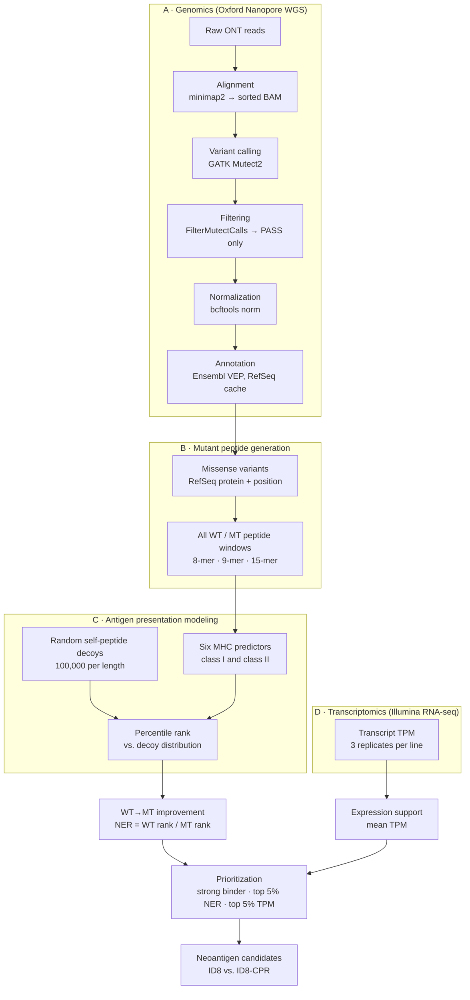

# Computational Discovery of Neoantigen Candidates in Cisplatin-Resistant Ovarian Cancer

<p align="center">
  <strong>Integrative Cancer Genomics · Transcriptomics · Tumor Immunology</strong>
</p>

<p align="center">
  
  
  
  
</p>

---

## Overview

**Can genomic alterations associated with chemotherapy resistance reveal potential targets for cancer immunotherapy?**

This project explores the genomic and transcriptomic landscape of murine ovarian cancer, with a particular focus on identifying candidate neoantigens associated with cisplatin resistance.

Using an integrative bioinformatics approach, the study combines Oxford Nanopore whole-genome sequencing (WGS) and Illumina bulk RNA sequencing to investigate somatic genomic alterations, characterize their transcriptional support, and prioritize potentially immunogenic mutant peptides.

The analysis focuses on two ovarian cancer cell line models:

- **ID8** - parental murine ovarian cancer cell line.
- **ID8-CPR** - cisplatin-resistant derivative.

By integrating genomic variant discovery, transcriptomic evidence, and MHC-binding predictions, this project aims to establish a computational framework for exploring the relationship between chemotherapy resistance and tumor antigenicity.

## Research Questions

The project addresses several interconnected questions:

1. **Genomic alterations:** What somatic variants can be identified in parental and cisplatin-resistant ovarian cancer models?
2. **Functional consequences:** Which variants result in protein-altering amino acid substitutions?
3. **Transcriptional support:** Which candidate mutations are supported by RNA expression evidence?
4. **Antigen presentation:** Which mutant peptides demonstrate promising predicted binding to MHC class I and class II molecules?
5. **Candidate prioritization:** Can the integration of genomic, transcriptomic, and immunological evidence identify high-priority neoantigen candidates?

## Biological Background

Ovarian cancer remains a major challenge in oncology, particularly in the context of treatment resistance and disease recurrence.

Cisplatin is a widely used platinum-based chemotherapeutic agent. However, the development of resistance can substantially limit its therapeutic effectiveness.

Neoantigens are tumor-specific peptides generated by somatic mutations. When processed and presented by major histocompatibility complex (MHC) molecules, they may be recognized by T cells and contribute to antitumor immune responses.

Understanding how genomic alterations differ between treatment-sensitive and resistant tumor models may provide insights into tumor evolution and potential immunotherapeutic opportunities.

This project connects three important dimensions of cancer research:

- **Cancer genomics:** identification and characterization of somatic alterations.
- **Cancer transcriptomics:** assessment of transcriptional evidence supporting candidate mutations.
- **Cancer immunology:** computational evaluation of potential MHC-presented mutant peptides.

---

## Workflow at a glance



---

## Repository structure

```
.
├── README.md
├── wgs_variant_calling/               # Part A: shell scripts, run in order
│   ├── 01_run_minimap_alignment.sh
│   ├── 02_run_mutation_calling.sh
│   ├── 03_run_mutation_filtering.sh
│   ├── 04_select_filtered_mutations.sh
│   ├── 05_print_stats.sh
│   ├── 06_norm_data.sh
│   └── 07_run_vep_with_refseq_cache.sh
└── neoantigen_prediction/             # Parts B–E
    ├── generate_wt_mt_mhc_peptide_windows.py
    ├── decoy_peptides.ipynb
    ├── affinity_tests.ipynb
    └── neoantigen_candidate_selection.ipynb
```

---

## Methods

### A. Somatic variant discovery from Oxford Nanopore WGS

Both cell lines were sequenced with Oxford Nanopore long reads and analysed with identical code (one loop over the sample list). Reference: mouse genome **GRCm38.p6** (NCBI GCF_000001635.26).

| Step | Script | Tool | What it does |
|---|---|---|---|
| 1. Alignment | `01_run_minimap_alignment.sh` | minimap2 `-ax map-ont`, samtools sort | Aligns long reads with the ONT preset; writes read-group metadata and the `MD` tag; streams straight into a coordinate-sorted BAM |
| 2. Variant calling | `02_run_mutation_calling.sh` | GATK Mutect2 | Calls SNVs and indels by local re-assembly |
| 3. Filtering | `03_run_mutation_filtering.sh` | GATK FilterMutectCalls | Labels every call with a statistical FILTER verdict (nothing is discarded at this point, so the decision stays auditable) |
| 4. PASS selection | `04_select_filtered_mutations.sh` | GATK SelectVariants `--exclude-filtered`, IndexFeatureFile | Keeps only calls that passed all filters and indexes the VCF |
| 5. QC | `05_print_stats.sh` | bcftools stats | Counts records, SNPs and indels before and after filtering |
| 6. Normalization | `06_norm_data.sh` | bcftools norm `-m -any` | Splits multi-allelic sites and left-aligns indels against the reference |
| 7. Annotation | `07_run_vep_with_refseq_cache.sh` | Ensembl VEP 102 (offline, RefSeq cache) | Adds gene, transcript, consequence (Sequence Ontology), HGVSc/HGVSp, protein position, amino-acid change, UniProt/CCDS/TSL, 5 kb flanking context |

A chromosome-synonym file maps NCBI contig names (`NC_000067.6`, …) to the names used by the VEP cache, so the NCBI reference could be annotated with the RefSeq transcript set.

### B. From DNA variants to mutant peptides

Protein-altering (**missense**) variants were extracted from the VEP output: one record per mutation × RefSeq transcript, carrying the RefSeq protein ID, protein position, and reference/mutant amino acid.

`generate_wt_mt_mhc_peptide_windows.py` then builds, for every missense mutation, **every possible peptide window that contains the mutated residue**, in matched wild-type (WT) and mutant (MT) pairs:

| MHC molecule | Class | Peptide length |
|---|---|---|
| H2-K<sup>b</sup> | I | 8 aa |
| H2-D<sup>b</sup> | I | 9 aa |
| I-A<sup>b</sup> | II | 15 aa |

(the three H-2<sup>b</sup> molecules of the C57BL/6 background in which ID8 originates). Windows are generated with a sliding approach: a mutation at protein position *p* is placed at every offset 1…L of a window of length L that still fits inside the protein.

Built-in quality control — a mutation is **skipped and logged with an explicit reason** if the protein ID cannot be resolved (including versionless fallback and ambiguity detection), the position is out of bounds, the reference amino acid in the variant table disagrees with the protein FASTA, or the window contains non-standard residues. The reference-amino-acid cross-check guarantees that the genomic and protein coordinate systems are consistent. The script is general: any allele name and any peptide length can be passed through `--alleles`.

### C. Modeling antigen presentation with six independent predictors

Each WT and MT peptide was scored by an ensemble of complementary, state-of-the-art predictors:

| Class | Predictor | Reported value |
|---|---|---|
| I (8-, 9-mers) | **MixMHCpred** | presentation score |
| I | **NetMHCpan-4.2** | binding-affinity score (BA) |
| I | **MHCflurry** | predicted affinity (nM) |
| II (15-mers) | **MixMHC2pred-2** | %rank |
| II | **NetMHCIIpan-4.3** | predicted affinity (nM) |
| II | **hmMHC** | −10·log-odds score |

Using several predictors with different architectures and training data reduces dependence on the quirks of any single model.

**Decoy-based percentile ranks.** The raw outputs of different tools are on incompatible scales, and the built-in percentile ranks of the tools are not directly comparable. Therefore, a common empirical reference was built (`decoy_peptides.ipynb`): **100,000 random peptides per length** (8, 9, 15) sampled uniformly from all windows of the mouse proteome (RefSeq proteins, standard amino acids only, fixed random seeds, no duplicates). Decoys were scored by the very same predictors. The score of every candidate peptide was then converted into an **empirical percentile rank within the decoy distribution of the same length** (lower = better binder, with the direction handled correctly for each tool). This puts all six predictors on one interpretable scale: a peptide at the 2nd percentile binds better than 98% of random self-peptides.

Engineering safeguards in `affinity_tests.ipynb`: predictions are generated per sample × peptide type × length batch, each run is logged, row counts are validated after every merge (`validate="one_to_one"`), and the combined table is written per sample and length.

### D. Transcriptional support

Illumina bulk RNA-seq (three biological replicates per cell line) was quantified at transcript level (TPM). Replicate TPMs were averaged per line and joined to every peptide window through its **RefSeq transcript ID**, so that a candidate is evaluated against the expression of the exact transcript that carries the mutation.

### E. Prioritization of neoantigen candidates

`neoantigen_candidate_selection.ipynb` integrates everything:

1. For each peptide, **mean and median percentile rank across the predictors** of the relevant class are computed.
2. **WT → MT change** is quantified as the *neoantigen enrichment ratio*  
   `NER = WT percentile rank / MT percentile rank`  
   (ranks are floored at 50 / N<sub>decoys</sub> to avoid division by zero). A large NER means that the mutation turned a poor binder into a good one.
3. Only **predicted strong binders** are retained: MT percentile rank ≤ **2 %**.
4. For each gene, the best peptide is kept, and candidates are plotted as **NER vs. TPM** (log–log), in the style of published neoantigen-prioritization figures.
5. **High-priority candidates** are those falling in the **top 5 % of both NER and TPM** — i.e. mutations that substantially improve predicted presentation *and* sit in highly expressed transcripts.
6. The same analysis is repeated **per predictor and per peptide length**, to show which candidates are supported by one tool only and which are reproducible across tools.
7. A comparison of missense mutations between ID8 and ID8-CPR (Venn diagram) separates mutations shared with the parental line from those specific to the resistant derivative.

---

## Software

| Purpose | Tools |
|---|---|
| Alignment and variant discovery | minimap2, samtools, GATK 4 (Mutect2), bcftools |
| Annotation | Ensembl VEP 102 (RefSeq cache, GRCm38) |
| MHC-binding prediction | MixMHCpred, NetMHCpan-4.2, MHCflurry, MixMHC2pred-2, NetMHCIIpan-4.3, hmMHC |
| Analysis | Python 3.11, NumPy, pandas, SciPy, Biopython, Matplotlib, matplotlib-venn, openpyxl |

NetMHCpan and NetMHCIIpan are distributed by DTU under an academic licence and must be downloaded by the user; they are not included here.

## Reproducing the analysis

```bash
# Part A: genomics (HPC; edit SAMPLES and paths at the top of each script)
bash wgs_variant_calling/01_run_minimap_alignment.sh
# ... 02 → 07 in order

# Part B: peptide windows
python neoantigen_prediction/generate_wt_mt_mhc_peptide_windows.py \
    --input-table  <missense_mutations.tsv> \
    --protein-fasta <RefSeq_protein.faa> \
    --output-peptides <ID8_MT_WT_windows.tsv> \
    --output-skipped  <ID8_skipped.tsv>

# Parts C–E: run the notebooks in this order
#   decoy_peptides.ipynb → affinity_tests.ipynb → neoantigen_candidate_selection.ipynb
```
