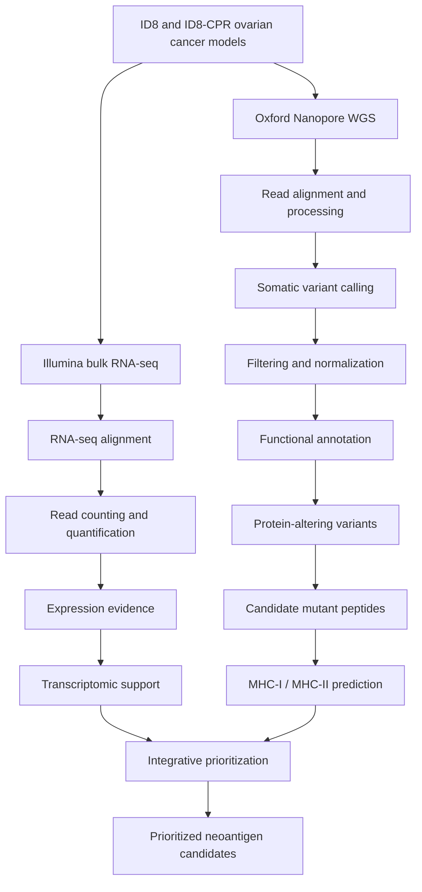

# Computational Discovery of Neoantigen Candidates in Cisplatin-Resistant Ovarian Cancer

  <strong>Integrative Cancer Genomics · Transcriptomics · Tumor Immunology</strong>

  
  
  
  

---

## Overview

**Can genomic alterations associated with chemotherapy resistance reveal potential targets for cancer immunotherapy?**

This project explores the genomic and transcriptomic landscape of murine ovarian cancer, with a particular focus on identifying candidate neoantigens associated with cisplatin resistance.

Using an integrative bioinformatics approach, the study combines Oxford Nanopore whole-genome sequencing (WGS) and Illumina bulk RNA sequencing to investigate somatic genomic alterations, characterize their transcriptional support, and prioritize potentially immunogenic mutant peptides.

The analysis focuses on two ovarian cancer cell line models:

- **ID8** — parental murine ovarian cancer cell line.
- **ID8-CPR** - cisplatin-resistant derivative.

By integrating genomic variant discovery, transcriptomic evidence, and MHC-binding predictions, this project aims to establish a computational framework for exploring the relationship between chemotherapy resistance and tumor antigenicity.

## Research Questions

The project addresses several interconnected questions:

1. **Genomic alterations:** What somatic variants can be identified in parental and cisplatin-resistant ovarian cancer models?
2. **Functional consequences:** Which variants result in protein-altering amino acid substitutions?
3. **Transcriptional support:** Which candidate mutations are supported by RNA expression evidence?
4. **Antigen presentation:** Which mutant peptides demonstrate promising predicted binding to MHC class I and class II molecules?
5. **Candidate prioritization:** Can the integration of genomic, transcriptomic, and immunological evidence identify high-priority neoantigen candidates?

## Biological Background

Ovarian cancer remains a major challenge in oncology, particularly in the context of treatment resistance and disease recurrence.

Cisplatin is a widely used platinum-based chemotherapeutic agent. However, the development of resistance can substantially limit its therapeutic effectiveness.

Neoantigens are tumor-specific peptides generated by somatic mutations. When processed and presented by major histocompatibility complex (MHC) molecules, they may be recognized by T cells and contribute to antitumor immune responses.

Understanding how genomic alterations differ between treatment-sensitive and resistant tumor models may provide insights into tumor evolution and potential immunotherapeutic opportunities.

This project connects three important dimensions of cancer research:

- **Cancer genomics:** identification and characterization of somatic alterations.
- **Cancer transcriptomics:** assessment of transcriptional evidence supporting candidate mutations.
- **Cancer immunology:** computational evaluation of potential MHC-presented mutant peptides.

## Experimental Models and Data

| Component | Description |
|---|---|
| Biological model | Murine ovarian cancer |
| Parental cell line | ID8 |
| Resistant cell line | ID8-CPR |
| DNA sequencing | Oxford Nanopore WGS |
| RNA sequencing | Illumina bulk RNA-seq |
| Reference genome | Mus musculus, GRCm38.p6 |
| Primary objective | Candidate neoantigen discovery and prioritization |

The integration of long-read genomic sequencing and short-read transcriptomic data provides complementary perspectives on the molecular characteristics of the two cancer models.

## Computational Workflow

The analytical workflow consists of five major stages.

### 1. Whole-Genome Sequencing Processing

Oxford Nanopore sequencing data were processed to characterize genomic variation.

The workflow included:

- Alignment of long sequencing reads to the mouse reference genome using **Minimap2**.
- Alignment processing and quality control using **SAMtools**.
- Independent tumor-only somatic variant calling using **GATK Mutect2**.
- Variant filtering with **FilterMutectCalls**.
- Variant normalization and processing using **BCFtools**.
- Functional annotation using **Ensembl Variant Effect Predictor (VEP)** with RefSeq annotations.

**Objective:** Generate annotated candidate somatic variants for downstream functional and immunological analyses.

### 2. Variant Characterization and Functional Annotation

Identified variants were further investigated to determine their potential functional consequences.

Particular attention was given to:

- Protein-altering variants.
- Missense mutations.
- Amino acid substitutions.
- Variants with potential implications for tumor-specific peptide generation.

This stage helped narrow the initial genomic variant sets to candidates relevant to downstream neoantigen prediction.

### 3. Transcriptomic Analysis

Illumina bulk RNA-seq data were processed to characterize gene expression and evaluate transcriptional evidence.

The analysis included:

- RNA-seq read alignment.
- Gene-level read counting.
- Expression quantification.
- Assessment of expression support for genes containing candidate variants.

Integrating DNA and RNA sequencing evidence is important because a genomic alteration alone does not establish that its corresponding mutant protein or peptide is expressed.

### 4. MHC Binding Prediction

Potential mutant peptides were evaluated using six complementary computational prediction tools targeting MHC class I and class II binding.

The analysis considered:

- Predicted mutant peptide–MHC binding.
- Wild-type versus mutant peptide binding characteristics.
- Prediction percentile ranks.
- Relative enrichment of mutant peptide binding compared with the corresponding wild-type sequence.

Using multiple prediction approaches provides a broader assessment of candidate peptide–MHC interactions than relying on a single prediction algorithm.

### 5. Integrative Neoantigen Prioritization

The final stage combined evidence from genomic, transcriptomic, and immunological analyses.

Candidate prioritization considered:

- Confidence in variant identification.
- Predicted functional consequences.
- Transcriptomic support.
- MHC binding prediction scores.
- Mutant versus wild-type peptide binding characteristics.

The objective was to identify a shortlist of expressed, protein-altering mutation-derived peptide candidates with promising predicted MHC-binding properties.

## Workflow Summary

## Computational Tools

| Tool | Application |
|---|---|
| Minimap2 | Long-read sequence alignment |
| SAMtools | Alignment processing |
| GATK Mutect2 | Somatic variant calling |
| FilterMutectCalls | Variant filtering |
| BCFtools | Variant normalization and processing |
| Ensembl VEP | Functional variant annotation |
| RNA-seq analysis tools | Transcriptomic processing and quantification |
| MHC prediction tools | Mutant peptide–MHC binding prediction |

## Research Significance

This project explores a computational connection between two important challenges in cancer treatment: chemotherapy resistance and tumor immunogenicity.

By integrating long-read genomic sequencing, bulk transcriptomics, and peptide-MHC binding prediction, the workflow provides a framework for moving from raw sequencing data toward biologically interpretable candidate neoantigens.

The broader scientific motivation is to understand whether genomic changes associated with treatment-resistant cancer models may also reveal potential targets for immune recognition.

## Reproducibility

Please refer to the individual scripts and notebooks for implementation details.

## Research Interests

This work reflects my broader research interests in:

- Cancer bioinformatics and computational oncology.
- Tumor evolution and therapy resistance.
- Cancer immunology and neoantigen discovery.
- Genomic and transcriptomic data integration.
- Computational approaches to personalized cancer immunotherapy.

---
